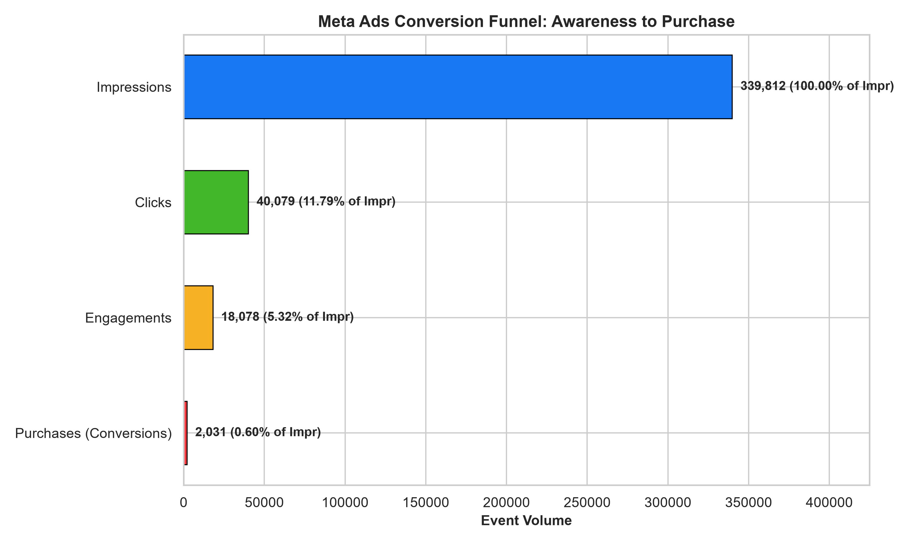
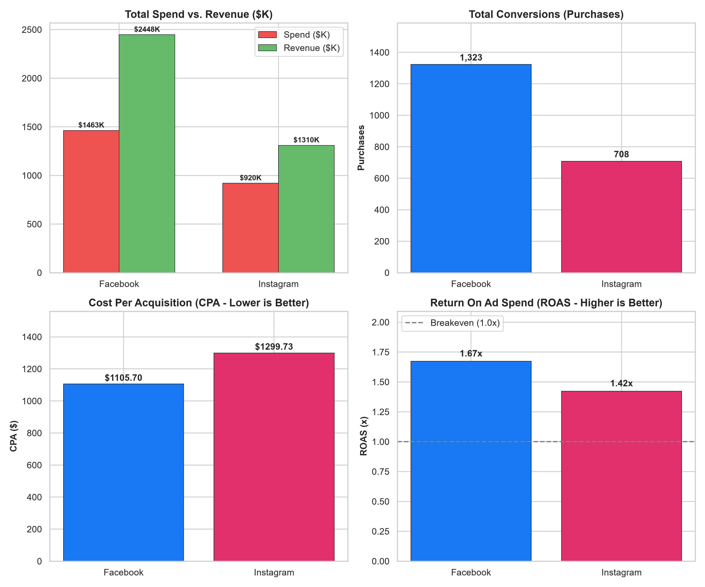
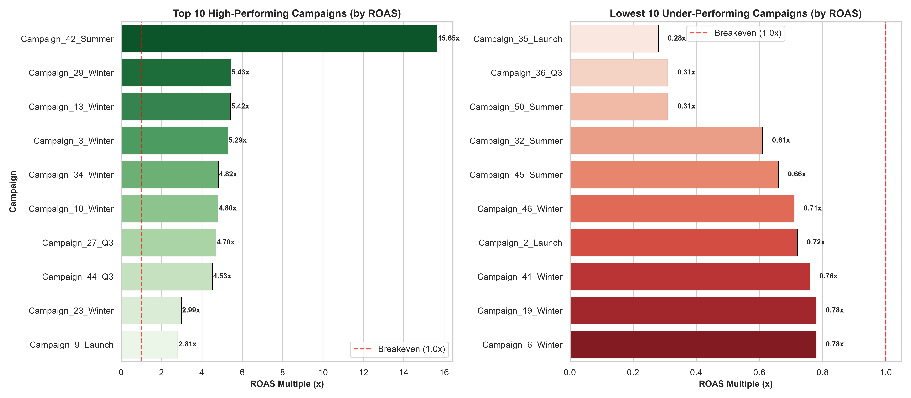
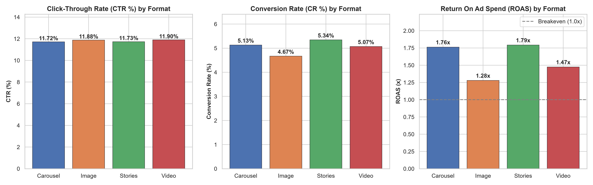
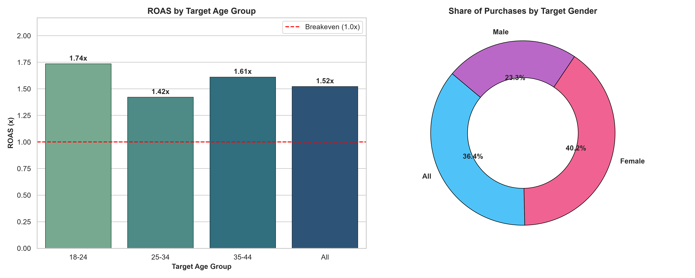

# Meta Ads Campaign Performance Analysis

[](https://www.python.org/)
[](https://pandas.pydata.org/)
[](https://www.mysql.com/)
[](https://powerbi.microsoft.com/)
[](LICENSE)

An end-to-end data analytics and business intelligence project analyzing Facebook and Instagram advertising campaign performance, customer acquisition efficiency, audience demographic response, and return on ad spend (ROAS).

---

## 📌 Executive Summary

* **Total Ad Spend Analyzed:** **$2,383,051.62** across **48 active campaigns** (100% budget utilization)
* **Delivery Scale:** **339,812 impressions** delivered across **312,127 unique users**
* **Engagement & Conversion:** **40,079 clicks** (**11.79% CTR**) and **2,031 verified purchases** (**5.07% Conversion Rate**)
* **Gross Revenue Generated:** **$3,757,350.00**
* **Portfolio Efficiency:** **1.58x ROAS** at a blended **$1,173.34 Cost Per Acquisition (CPA)**
* **Identified Inefficiency:** **$312,751.60 wasted** on 5 negative-ROI campaigns (-$174,000 net loss)

---

## 🏗️ Project Architecture & Folder Structure

```text
Meta-Ads-Campaign-Analysis/
│
├── data/
│   ├── raw/                           # Original, untouched raw CSV files (400,000 events)
│   └── processed/                     # Cleaned, standardized datasets (Star Schema)
│
├── notebooks/
│   └── exploratory_analysis.ipynb     # Jupyter Notebook for interactive EDA & visuals
│
├── src/
│   ├── data_cleaning.py               # Phase 3: Automated data cleaning & recovery pipeline
│   ├── eda.py                         # Phase 4: Statistical EDA and figure generation
│   ├── metrics.py                     # Standardized marketing KPI calculation formulas
│   ├── database_connection.py         # Phase 5: MySQL & relational database ingestion
│   └── run_sql_analysis.py            # Phase 6: Automated SQL business query runner
│
├── sql/
│   ├── schema.sql                     # Phase 5: MySQL DDL schema, primary & foreign keys, indexes
│   ├── campaign_analysis.sql          # Phase 6: Top/bottom campaigns & budget utilization
│   ├── audience_analysis.sql          # Phase 6: Age, gender, and country distribution queries
│   └── performance_analysis.sql       # Phase 6: Cross-platform, monthly trends & ROI queries
│
├── dashboard/
│   ├── meta_ads_dashboard.pbix        # Phase 7: Interactive 4-page Power BI dashboard report
│   ├── dax_measures.md                # Complete DAX measures reference library
│   ├── dashboard_specification.md     # Visual design, field wells, and filter specifications
│   └── meta_ads_powerbi_data.xlsx     # Consolidated 1-click Power BI Excel dataset
│
├── reports/
│   ├── business_insights.md           # Phase 8: Strategic executive findings & recommendations
│   └── figures/                       # High-resolution charts exported from Matplotlib/Seaborn
│
├── screenshots/                       # Dashboard visuals and chart figures for portfolio view
│   ├── conversion_funnel.png
│   ├── platform_performance_comparison.png
│   ├── top_bottom_campaigns_roas.png
│   ├── monthly_ad_trends.png
│   ├── ad_format_performance.png
│   └── audience_demographics_analysis.png
│
├── requirements.txt                   # Project dependencies (Pandas, Seaborn, SQLAlchemy, etc.)
├── README.md                          # Project documentation
└── .gitignore                         # Version control exclusion rules
```

---

## ⚙️ Technology Stack

| Technology | Purpose in Project |
| :--- | :--- |
| **Python 3.13** | Pipeline orchestration, data validation, and automated workflows |
| **Pandas & NumPy** | Data wrangling, date standardization, and KPI computations |
| **Matplotlib & Seaborn** | Publication-grade statistical visualizations and figure generation |
| **MySQL 8.0 & SQL** | Relational Star Schema data warehousing, CTEs, and business analytics queries |
| **Power BI Desktop** | 4-page interactive executive dashboard, DAX calculations, and data modeling |
| **Git & GitHub** | Version control, documentation hygiene, and portfolio presentation |

---

## 📐 Core Marketing KPIs & Formulas

| Metric | Business Definition | Mathematical Formula | Portfolio Value |
| :--- | :--- | :---: | :---: |
| **Ad Spend** | Total advertising expenditure | $\sum \text{Campaign Budgets}$ | **\$2,383,051.62** |
| **CTR** | Click-Through Rate | $\frac{\text{Clicks}}{\text{Impressions}} \times 100$ | **11.79%** |
| **CPC** | Cost Per Click | $\frac{\text{Spend}}{\text{Clicks}}$ | **\$59.46** |
| **CPM** | Cost Per Mille (1,000 Impressions) | $\frac{\text{Spend}}{\text{Impressions}} \times 1000$ | **\$7,012.85** |
| **CR** | Conversion Rate | $\frac{\text{Purchases}}{\text{Clicks}} \times 100$ | **5.07%** |
| **CPA** | Cost Per Acquisition | $\frac{\text{Spend}}{\text{Purchases}}$ | **\$1,173.34** |
| **ROAS** | Return On Ad Spend | $\frac{\text{Revenue}}{\text{Spend}}$ | **1.58x** |

---

## 📊 Visual Insights & Findings

### 1. The Conversion Funnel

- **Top of Funnel:** 339,812 impressions delivered to 312,127 users (1.09 frequency).
- **Middle of Funnel:** 40,079 clicks (11.79% CTR) and 18,078 social engagements (likes, comments, shares).
- **Bottom of Funnel:** 2,031 purchases generating \$3.76M gross revenue (5.07% click-to-purchase conversion rate).

---

### 2. Platform Comparison: Facebook vs. Instagram


```text
┌──────────────────────────────────────────┬──────────────────────────────────────────┐
│          FACEBOOK (SALES ENGINE)         │        INSTAGRAM (ENGAGEMENT HUB)        │
├──────────────────────────────────────────┼──────────────────────────────────────────┤
│ • Spend: $1,462,840.40 (61.4% share)     │ • Spend: $920,211.22 (38.6% share)       │
│ • Purchases: 1,323 (65.1% share of sales)│ • Purchases: 708 (34.9% share of sales)  │
│ • CPC: $57.62 (8% cheaper)               │ • CPC: $62.64                            │
│ • CPA: $1,105.70 ($194 lower cost/sale)  │ • CPA: $1,299.73                         │
│ • ROAS: 1.67x (17.6% higher return)      │ • ROAS: 1.42x                            │
│ • CTR: 11.76%                            │ • CTR: 11.86% (Higher click engagement)  │
└──────────────────────────────────────────┴──────────────────────────────────────────┘
```

---

### 3. Campaign Performance: Top 10 vs. Bottom 10 (ROAS)

- **Star Campaign:** `Campaign_42_Summer` achieved **15.65x ROAS** with an ultra-low **\$118.18 CPA**.
- **Seasonal Consistency:** Winter campaigns (`Campaign_29_Winter`, `Campaign_13_Winter`, `Campaign_3_Winter`) delivered predictable returns between **4.8x and 5.4x ROAS**.
- **Quantified Waste:** The 5 worst-performing campaigns (`Campaign_35_Launch`, `Campaign_36_Q3`, `Campaign_50_Summer`, `Campaign_32_Summer`, `Campaign_45_Summer`) burned **\$312,751.60 in ad spend** for only \$138,750 in revenue (**-\$174,000 net loss**).

---

### 4. Ad Creative Formats & Audience Demographics


- **Format Effectiveness:** **Stories (1.79x ROAS, \$1,032 CPA)** and **Carousel (1.76x ROAS, \$1,049 CPA)** heavily outpaced single **Static Images (1.28x ROAS, \$1,446 CPA)**.
- **Top Demographics:** Age **18–24** is the top converting cohort (**1.74x ROAS**).
- **The Golden Segment:** Combining **Age 18–24 with Stories format** delivered a peak **2.11x ROAS** and **\$874.83 CPA**.
- **International Opportunities:** **United States (645 purchases)** and **UK (283 purchases)** drive scale, while **Japan (6.32%)** and **Mexico (6.12%)** achieved the highest click-to-purchase conversion intent.

---

## 📈 Power BI 4-Page Dashboard Layout

1. **Executive Overview:** 6 high-level KPI cards, Monthly Spend vs. Revenue trend line, Platform spend & conversion donut charts, and quick campaign matrix.
2. **Campaign Performance:** Top 10 vs. Bottom 10 ROAS rankings, Spend vs. ROAS quadrant scatter plot, and budget pacing tables.
3. **Audience Analysis:** Target age group response, gender conversion share, country geographic bubble map, and creative-demographic heatmap.
4. **Conversion & ROI Analysis:** Full-funnel drop-off waterfall, creative format comparison (Stories/Carousel/Video/Image), and dayparting heatmap.

---

## 🚀 Step-by-Step Setup Instructions

### 1. Clone the Repository
```bash
git clone https://github.com/<your-username>/Meta-Ads-Campaign-Performance-Analysis.git
cd Meta-Ads-Campaign-Performance-Analysis
```

### 2. Set Up Virtual Environment & Dependencies
```bash
# Create and activate virtual environment
python -m venv venv
.\venv\Scripts\Activate.ps1   # On Windows
source venv/bin/activate       # On macOS/Linux

# Install all required libraries
pip install -r requirements.txt
```

### 3. Run Data Cleaning & Transformation Pipeline
```bash
python src/data_cleaning.py
```
*Outputs cleaned Star Schema files to `data/processed/` and repairs Excel scientific notation corruption.*

### 4. Run Exploratory Data Analysis & Generate Visuals
```bash
python src/eda.py
```
*Generates and saves all 6 chart figures in `reports/figures/` and `screenshots/`.*

### 5. Ingest into Relational Database
```bash
# Automatically creates schema and ingests data into relational database
python src/database_connection.py

# Optional: To connect directly to MySQL Server
python src/database_connection.py --mysql
```

### 6. Execute SQL Business Analytics Queries
```bash
python src/run_sql_analysis.py
```
*Runs all queries in `sql/campaign_analysis.sql`, `sql/audience_analysis.sql`, and `sql/performance_analysis.sql`.*

### 7. Open Power BI Dashboard
1. Open **Power BI Desktop**.
2. Click **Get Data** $\rightarrow$ Select `dashboard/meta_ads_powerbi_data.xlsx`.
3. Load the sheets and copy the measures from `dashboard/dax_measures.md`.

---

## 💼 Interview Talking Points (Cheat Sheet)

When discussing this project in a data analyst job interview:

1. **Handling Data Defects in Python:** Explain how you diagnosed that Excel had converted authentic 5-character user IDs like `012e0` into scientific notation (`1.20E+01`), and built an automated recovery algorithm in Pandas that restored **99.96% of records**.
2. **Business Over Vanity Metrics:** Emphasize that while Instagram yielded a slightly higher CTR (11.86% vs 11.76%), Facebook was the true commercial winner—driving **1.67x ROAS** and acquiring customers at a **15% lower CPA** (\$1,105 vs \$1,299).
3. **Actionable Financial Recommendations:** Confidently state that defunding the 5 worst campaigns immediately frees up **\$312,751 in wasted capital**, which when redeployed to top-performing 4.8x–5.4x ROAS campaigns yields an estimated **+\$1.5M in incremental revenue**.

---

## 📜 License
This project is open-source and available under the [MIT License](LICENSE).
